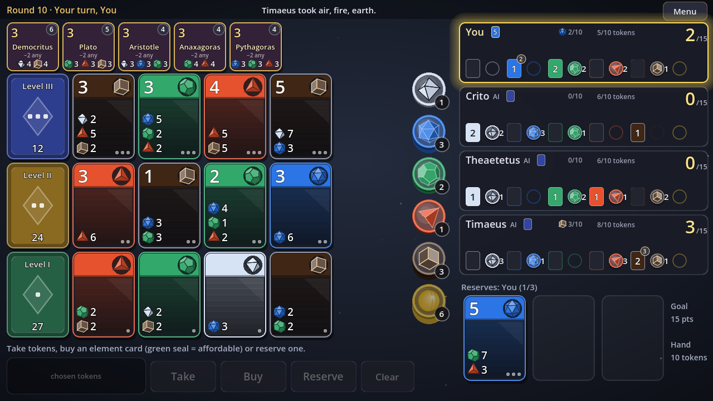
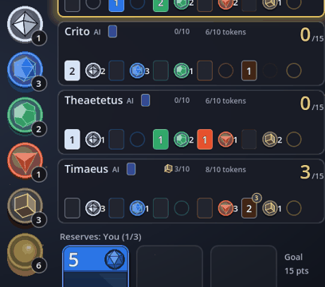
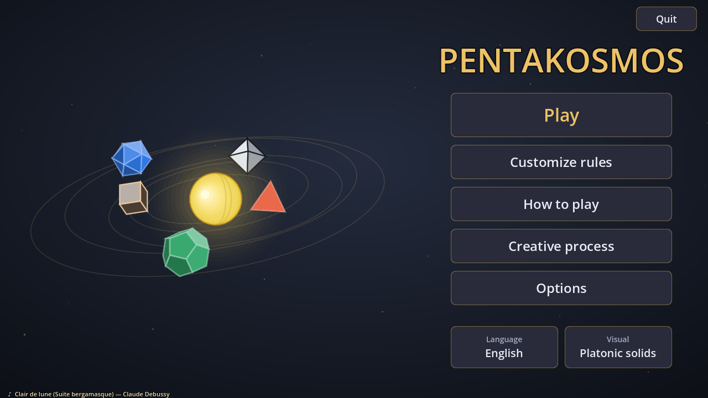
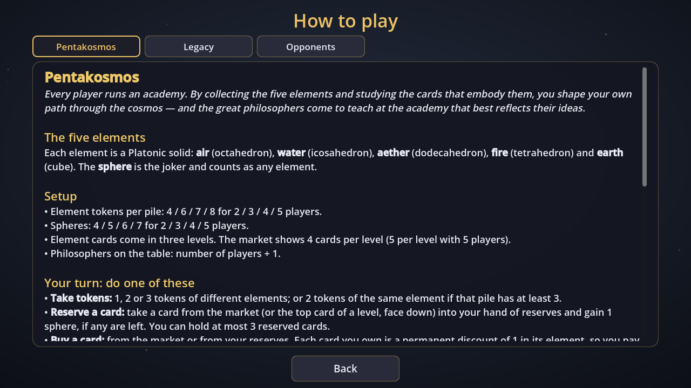
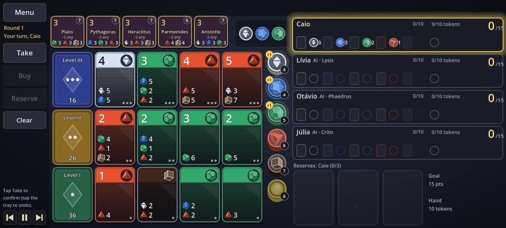

# Pentakosmos

*A card game of elements, academies and philosophers, inspired by the Platonic solids.*

**[Português abaixo / Portuguese below → LEIA-ME.md](LEIA-ME.md)**



<p align="center"></p>

Every player runs an academy. By collecting the five elements — **air, water, aether, fire and earth**, each one a Platonic solid — and buying the element cards that embody them, you shape your own path through the cosmos. Each card you own makes the next ones cheaper, and the great philosophers of Ancient Greece come to teach at the academy whose cards best reflect their ideas. The first academy to reach 15 points (or to master a single element) ends the game.

- 2 to 5 players, against friends on the same device or against computer opponents.
- Two rule sets — **Pentakosmos** (the default) and **Archaic** — and every rule can be changed on its own.
- Statistics for every game, with JSON and CSV export.
- Computer opponents trained with a genetic algorithm and ranked by tournaments.
- 38 languages.
- Free and open source (MIT). Linux, Windows and Android.

## Download and play

Ready-to-play builds are published on the [Releases](https://github.com/estatisticomoura/pentakosmos/releases) page.

- **Linux:** unzip, then `chmod +x pentakosmos.x86_64 && ./pentakosmos.x86_64`.
- **Windows:** unzip and open `Pentakosmos.exe`. Windows may warn that the program is not signed; click "More info" and then "Run anyway".
- **Android (7.0 or newer):** download `pentakosmos.apk` on the phone and open it. Android will ask you to allow installing apps from that source (the browser or file manager); allow it once. The game runs in landscape with a layout made for touch: the action buttons are in a column on the left, the top bar lists what the opponents did since your last move, and everything is larger. Tap a card to select it and see its details, tap it again to buy; tap a philosopher to see its requirement. The layout can also be chosen in *Options*: automatic, computer or touch.

The rules are explained inside the game, in **How to play**. The story of how the game was made is in **Creative process** (also in [docs/CREATIVE_PROCESS.md](docs/CREATIVE_PROCESS.md)).

| | |
|---|---|
|  |  |

On a phone (20:9 landscape):



## The rules in short

On your turn, do one thing:

- **Take tokens:** 1, 2 or 3 tokens of different elements, or 2 of the same element from a pile that is large enough.
- **Reserve a card** from the market (or face down from the top of a pile) and gain a **sphere**, the joker.
- **Buy a card.** Every card you own is a permanent discount of 1 in its element.

At the end of your turn, a **philosopher** joins your academy if your cards meet their requirement (in the Archaic mode, a **writer** too). The last round starts when someone reaches 15 points or, in the Pentakosmos rules, gets 10 points from cards of a single element (the **specialization victory**).

| Rule | Pentakosmos | Archaic |
|---|---|---|
| Element tokens per pile (2/3/4/5 players) | 4/6/7/8 | 4/5/7/8 |
| Spheres (jokers) | 4/5/6/7 | 5 |
| Take 2 of the same element from a pile of | 3 or more | 4 or more |
| Market with 5 players | 5 cards per group | 4 cards per group |
| Philosopher requirement | total −2, any elements | exact |
| Philosopher points | 3, then 2, then 1 | 3 each |
| Writers | no | 2 on the table, exact requirement, 1 point each |
| Deck | Pentakosmos (formulas) | Archaic (formulas) |
| Specialization victory | 10 points in one element | off |
| Token limit · points to win | 10 · 15 (adjustable) | 10 · 15 (adjustable) |
| Time per move (against AIs · between people) | no limit · 60 s (adjustable) | no limit · 60 s (adjustable) |

The cards come in three groups — **basic**, **intermediate** and **advanced** — and the back of each one shows a star with 1, 2 or 3 planets.

**Writers.** The ten writers (Sappho, Homer, Hesiod, Pindar, Herodotus, Aeschylus, Sophocles, Aristophanes, Thucydides and Euripides) ask for cards in the element combinations the philosophers do not use: 3 + 3 of two elements, or 2 + 2 + 2 of three. Each one is worth 1 point and stays outside the philosophers' 3 / 2 / 1 sequence; one philosopher and one writer can arrive in the same turn. The "Academy" option chooses philosophers and writers, philosophers only, writers only or neither.

## The Pentakosmos deck

The 90 element cards are generated by **18 formulas**. Each formula defines a card's group, points and cost relative to its own element, following the cycle air → water → aether → fire → earth → air. Applied to the five elements, each formula yields five cards that mirror one another, so no element is favoured. The formulas are in `scripts/core/defs.gd` (`FORMULAS_CAIO`) and explained in [docs/CREATIVE_PROCESS.md](docs/CREATIVE_PROCESS.md).

The **Archaic deck** also has 90 cards generated by 18 formulas (`FORMULAS_ARCAICO`), with the same average costs per group (4.12 / 6.83 / 10.75) but its own molds, on other positions of the cycle.

## Statistics

Every game with at least one human player is recorded: the full rules, the deck, the duration, the cards bought by group and element, the points per element, philosophers and writers, and the average time per move. The **Statistics** screen filters by player, period (from 1 week to all time) and rules, and exports everything as JSON (which can be imported on another device without duplicating games) or as CSV for spreadsheets.

## Computer opponents

They are named after characters from Plato's dialogues, from the gentlest to the strongest: **Lysis**, **Crito**, **Phaedrus**, **Theaetetus** and **Timaeus**.

- **Lysis** plays for the immediate gain.
- **Crito** is a strategist: it chooses a path (higher-level cards and a philosopher), reserves early and revises its plan.
- **Phaedrus, Theaetetus and Timaeus** are three candidates ranked by a tournament:
  - *evolved:* the strategist with 24 parameters tuned by a genetic algorithm;
  - *tactical:* the strategist plus "surgical" denial and an end-game search that simulates the rest of the game, drawing the hidden cards at random (it never peeks);
  - *mixed:* the tactical opponent with the evolved parameters.

In the current tournaments, Timaeus is the mixed opponent, Theaetetus the tactical one and Phaedrus the evolved one. There are separate trainings for the Pentakosmos rules, the Archaic rules and any other combination.

### Training them again

From the project folder, with Godot 4.7.2 installed and Python 3:

```
python3 tools/evoluir.py              # genetic algorithm, general training (~40 min on 16 cores)
python3 tools/torneio.py              # tournament: decides who is Phaedrus, Theaetetus and Timaeus
python3 tools/evoluir.py --modo house     # specialised training for the Pentakosmos rules
python3 tools/torneio.py --modo house
python3 tools/evoluir.py --modo classico  # specialised training for the Archaic rules
python3 tools/torneio.py --modo classico
```

- The genetic algorithm uses 16 individuals per generation, 1,000 games per individual and 30 generations, with elitism, tournament selection, crossover and decaying mutation. The rules of each game are drawn at random (number of players, rule variants, hand limit, goal), and the champion is validated on games it has never seen.
- The results are written to `data/ia_evoluida*.json` and `data/niveis*.json` (`house` = Pentakosmos, `classico` = Archaic). The game uses the specialised files when the rules match a preset exactly, and the general ones otherwise.
- `--continuar` resumes an interrupted run. If Godot was installed with Flatpak, add `--godot "flatpak run org.godotengine.Godot"`.

## Building from the source

1. Install **Godot 4.7.2** ([godotengine.org](https://godotengine.org), or `flatpak install flathub org.godotengine.Godot`).
2. Open the editor, click **Import** and choose `project.godot`. Press F5 to play.
3. To export: *Editor → Manage Export Templates → Download and Install*, then *Project → Export* and choose **Linux**, **Windows**, **macOS** or **Android**. From the command line:
   ```
   godot --headless --path . --export-release "Linux" build/linux/pentakosmos.x86_64
   godot --headless --path . --export-release "Windows" build/windows/Pentakosmos.exe
   godot --headless --path . --export-release "macOS" build/mac/Pentakosmos.zip
   ```
   The macOS build is a universal app (Intel and Apple Silicon) with an ad-hoc signature, not notarized: on the Mac, unzip it, then right-click *Pentakosmos.app* → *Open* the first time (or allow it in *System Settings → Privacy & Security*).
4. Android also needs JDK 17 and the Android SDK (Platform-Tools, Build-Tools and Command-line Tools), configured in *Editor → Editor Settings → Export → Android*. The preset exports an unsigned APK; sign it with your own key (keep the same key for every version, or phones will refuse to update):
   ```
   godot --headless --path . --export-release "Android" build/android/unsigned.apk
   python3 tools/assinar_apk.py nova-chave ~/pentakosmos-key.pem      # only once
   python3 tools/assinar_apk.py assinar ~/pentakosmos-key.pem build/android/unsigned.apk build/android/pentakosmos.apk
   ```

## Translations

On first launch the game uses the device's language when it has it, and English otherwise; the *Language* button on the start screen offers 38 languages: English, Portuguese, the 24 official languages of the European Union, and Albanian, Belarusian, Bosnian, Catalan, Icelandic, Luxembourgish, Macedonian, Montenegrin, Norwegian, Romansh, Russian, Serbian, Turkish and Ukrainian.

- Texts are written in English in the code (`L.t("...")`, `L.f("...", {...})` in `scripts/core/lang.gd`). Each translation is `data/lang/<code>.json`: `{"English text": "translation"}`. Missing texts fall back to English.
- The long texts (rules and creative process) are in `data/texts/<page>_<code>.txt`; for now there are English and Portuguese versions.
- `python3 tools/idiomas.py` shows what is missing in each language and checks the `{placeholders}`. `python3 tools/idiomas.py --modelo xx` creates or completes a new language file.
- The translations were drafted with the help of AI. **Corrections by native speakers are very welcome** — see [CONTRIBUTING.md](CONTRIBUTING.md).

## Art and sound

Everything is drawn in code, so the game runs without any image file. To use your own art, drop PNGs into:

- `assets/cards/pentakosmos/` and `assets/cards/arcaico/` — one file per card (names listed in `assets/cards/CARD_LIST.csv`) and `back_l1.png` … `back_l3.png`;
- `assets/philosophers/philosopher_1.png` … `philosopher_10.png` and `assets/writers/writer_1.png` … `writer_10.png`.

The icon (a black dodecahedron with gold edges) is generated by `python3 tools/gerar_icone.py` into `assets/icon/`.

Sound effects are `assets/sfx/<name>.ogg` (they take priority over the generated `.wav` files); `python3 tools/gerar_sons.py` regenerates the placeholder effects.

### Music

19 classical pieces, created for the game from public-domain compositions — no commercial recording is used. The scores come from the [Mutopia Project](https://www.mutopiaproject.org); the piano pieces are played with the [Salamander Grand Piano](https://archive.org/details/SalamanderGrandPianoV3) (a real grand piano recorded note by note, by Alexander Holm, CC BY 3.0), and the orchestral ones with the [VSCO 2 Community Edition](https://github.com/sgossner/VSCO-2-CE) (real orchestral instruments, by Versilian Studios, CC0). The scores were turned into performances with a melody that sings over the accompaniment, natural pedalling, gentle rubato and room reverberation; Grieg, Holst and Handel were arranged for orchestra.

In the start menu (and in the pause menu) the player chooses a playlist — **Calm**, **Lively**, **All** or a single piece. During the game, the small player next to the Menu button goes to the previous piece, pauses or skips to the next one; the name of each piece appears when it starts.

| Element | Piece |
|---|---|
| Air | Bach, *Air* (Orchestral Suite No. 3) |
| Water | Debussy, *Arabesque No. 1* |
| Fire | Handel, *La Réjouissance* (Music for the Royal Fireworks) |
| Earth | Grieg, *In the Hall of the Mountain King*; Mussorgsky, *Night on Bald Mountain* |
| Aether | Holst, *Thaxted* (the theme of "Jupiter"); Debussy, *Clair de lune* |
| Sphere | Johann Strauss II, *The Blue Danube* |

Also: Satie's three *Gymnopédies* and three *Gnossiennes*, Bach's *Goldberg Aria*, *Prelude in C* and *Toccata and Fugue in D minor*, Chopin's *Nocturne Op. 9 No. 2* and Vivaldi's *Summer*. Full credits and licenses are in the game (Creative process → Music) and in `data/music.json`. `python3 tools/musica/gerar_musica.py` regenerates every track from the scores.

## Project structure

```
scripts/core/   rules, game engine, AI, languages (no user interface)
scripts/ui/     screens, cards, tokens, philosophers, panels, visual theme
data/           AI training results, translations (lang/) and long texts (texts/)
assets/         optional art, sounds and music
tools/          genetic algorithm, tournament, translation checker, sound generator
tests/          headless simulations and interface tests
docs/           creative process and images
```

Tests, from the project folder:

```
godot --headless --path . --script res://tests/sim_test.gd -- house 3 normal 500
godot --headless --path . res://tests/ui_smoke.tscn -- 4 house
```

## Contributing and contact

Ideas, questions and stories about your games: **[Discussions](https://github.com/estatisticomoura/pentakosmos/discussions)**. Bugs: **[Issues](https://github.com/estatisticomoura/pentakosmos/issues)**. Pull requests are welcome; see [CONTRIBUTING.md](CONTRIBUTING.md).

## License and credits

- Code: [MIT License](LICENSE) — use it, change it, share it and even sell it; just keep the copyright notice.
- Texts, sounds and images in `data/texts/`, `assets/` and `docs/`: [CC BY 4.0](LICENSE-ASSETS.md).
- Created by **Caio Moura Quina** ([estatisticomoura](https://github.com/estatisticomoura)), with Claude (Anthropic) as programming partner.
- Made with [Godot Engine](https://godotengine.org).
